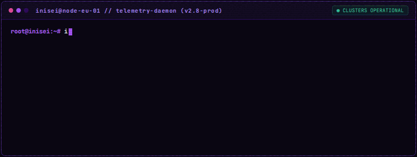
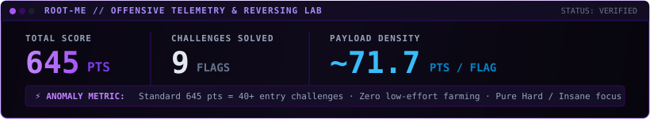

# `INISEI // ROMAN POHREBNIAK`
### Autonomous Systems & Distributed Backend Architect

 

  

 

<blockquote align="center">
<b>「 複雑さを制御できない者は、いずれその複雑さに飲み込まれる 」</b> 
<i>"Those who cannot tame complexity are doomed to be devoured by it."</i> 
— Designing self-healing distributed architectures engineered to run silently in the dark.
</blockquote>

 

## 🛡️ `SECURITY` — Offensive Telemetry & Reversing Lab

  

 

## ⚙️ `CORE` — Technical Arsenal & Architectural Invariants

| Domain | Production Core (Daily Fleet) | Systems & Network Layer | Research & Security |
| :-- | :-- | :-- | :-- |
| **Languages** | Python 3.12+, Go 1.24 | C, C++, x86-64 Assembly | Bash, Lua |
| **Architecture** | Asynchronous Event Streams, FSMs | Zero-Copy I/O (`splice`), socket tuning | Nanomites & `ptrace` exception routing |
| **Data & Queues** | PostgreSQL (WAL / Locks), Redis Streams | SQLite (WAL concurrency) | Transactional Outbox, CDC Debezium |
| **Network & Evasion** | Docker, Linux System Administration | TLS JA4 / HTTP2 Fingerprinting | White-box DFA AES, Binary Analysis |

 

## 🛰️ `SYSTEMS` — Featured Architectures

<table>
<tr>
<td width="50%" valign="top">

### `01` // Distributed Systems Platform Harness
**Go · Python · Docker · Invariants**

Unified engineering laboratory implementing deterministic Finite State Machines, Singleflight request coalescing, probabilistic XFetch early cache refreshes, and Kleppmann monotonic fencing locks.

</td>
<td width="50%" valign="top">

### `02` // High-Concurrency Event Ingestion Engine
**FastAPI · SQLite WAL · Redis Streams · Async Workers**

Industrial-grade distributed order and ticket processing cluster. Features transactional outbox patterns, sub-second polling backpressure, and guaranteed at-least-once delivery with zero data loss.

</td>
</tr>
<tr>
<td width="50%" valign="top">

### `03` // Anti-Detect & TLS Evasion Network
**TLS JA4 · HTTP/2 Frames · Proxy Fleet Orchestration**

Distributed egress network maintaining cryptographic TLS/JA4 handshake consistency, browser automation leak elimination (CDP mitigation), and automated proxy circuit breaking.

</td>
<td width="50%" valign="top">

### `04` // Systems Internals & Binary Reversing Lab
**Linux Kernel · ptrace · Nanomites · DFA AES**

Low-level security research laboratory exploring multi-process supervisor-worker architectures, dynamic CPU register injection via hardware traps (`SIGSEGV`/`SIGTRAP`), and white-box AES cryptanalysis.

</td>
</tr>
</table>

 

## ⚡ `ACTIVITY` — Autonomous Contribution Grid

  
   
  <i>Autonomous crawler traversing the contribution telemetry grid.</i>

 

## 📡 `TRANSMISSION` — Direct Comms

